<div dir="rtl" align="center">

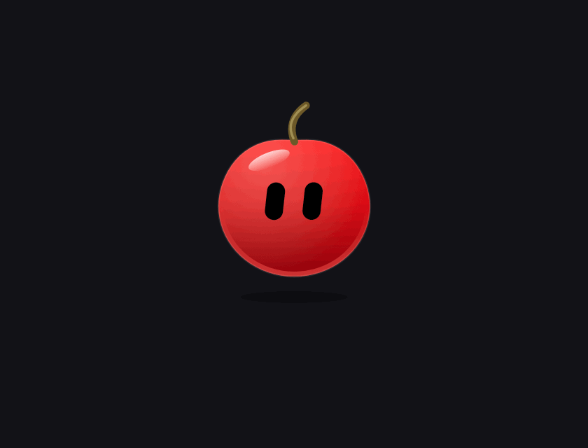

# Pixel 🍒
### העוזר הקטן שגר ב־notch של המק שלך

**AI בלחיצה · תיקון עברית/אנגלית · הכתבה · כיווץ קבצים · ועוד המון — עם Cherry, החבר הכי חמוד שהיה לכם על המסך**

## ⬇️ התקנה בשורה אחת (חינם)

</div>

```bash
curl -fsSL https://raw.githubusercontent.com/GorenCode/pixel-releases/main/install.sh | bash
```

<div dir="rtl" align="center">

פותחים את **Terminal** (⌘ רווח ← "Terminal"), מדביקים, Enter — ו־Cherry מופיע ב־notch 🍒

macOS 15 ומעלה · Mac עם Apple Silicon (M1 ומעלה) · מתעדכן לבד

</div>

---

<div dir="rtl">

## 🍒 תכירו את Cherry

Cherry הוא כדור אדום ומבריק עם עיניים שחורות — ומדי פעם הוא נזכר שהוא בעצם **דובדבן**: צומח לו גבעול עם עלה, מגיע תאום על אותו גבעול, העלה מסתובב כמו מסוק, הוא מבשיל מירוק לאדום, מלהטט בדובדבנים, ופורחת לו פריחת דובדבן 🌸

וכשאתם עובדים ב־Cursor, VS Code, ChatGPT, Claude או בטרמינל — **הוא פותח מקבוק ועובד איתכם**: כותב קוד, מריץ build, משגר רקטה כשמסיימים, צד באגים, ובונה חנות Shopify עם דשבורד מכירות 💸

</div>

<div align="center">
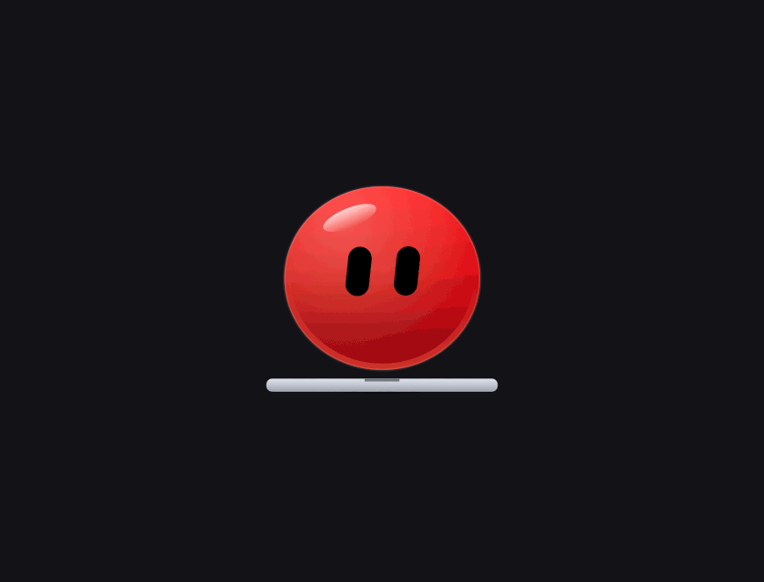 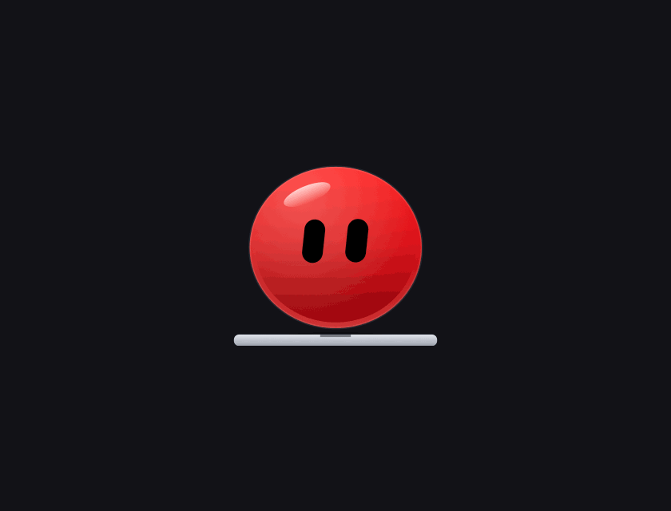 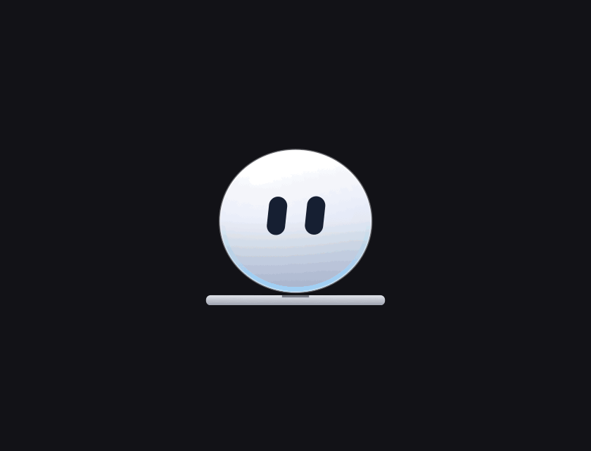
</div>

<div dir="rtl">

כל האנימציות פיזיקליות (קפיצים, מעיכה ומתיחה), העיניים זזות על כדור תלת־ממדי ומגיבות למה שאתם עושים — לסמן, למה שאתם מקלידים, ולמצב הרוח של הטקסט.

## 👀 עוד חברים לבחירה

Cherry, Orbi, רובוט, חתול, ארנב, רוח, צפרדע, פינגווין, דינוזאור, חייזר, תמנון, פנדה, אסטרונאוט, ברווז גומי, כוס קפה, אבוקדו, סליים, דרקון וחד־קרן — כל אחד עם הבעות משלו.

</div>

<div align="center">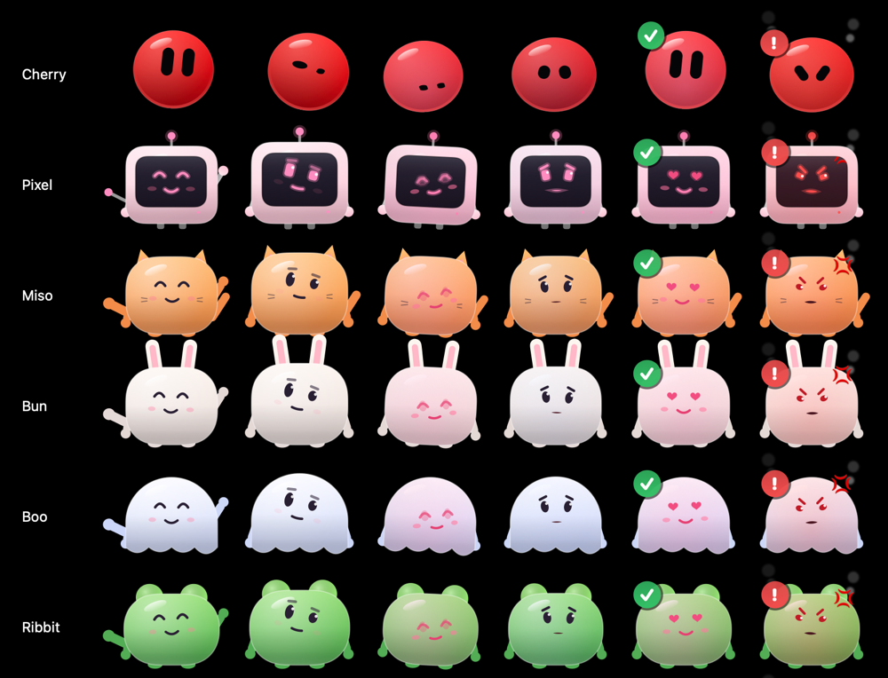</div>

---

<div dir="rtl">

## ✨ מה Pixel יודע לעשות

### 🤖 עוזר AI — בלי מפתחות API
מתחברים עם החשבון הקיים שלכם ב־**ChatGPT, Claude או Gemini** ושואלים מה־notch. התשובות יכולות לכלול **גרפים, טיימרים, טבלאות ורשימות** אמיתיים, לא רק טקסט. יש גם מצב Code ו־Worker לסוכנים, ואישור בקשות של Claude Code ישר מה־notch.

</div>

<div align="center">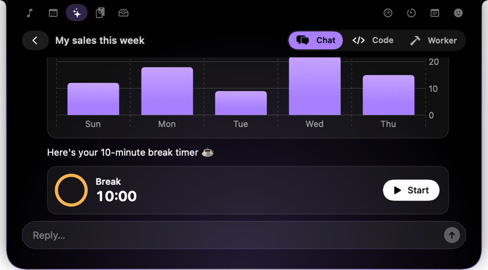</div>

<div dir="rtl">

### ✍️ על כל טקסט מסומן — ⌃⌘T
מסמנים טקסט בכל אפליקציה: **תרגום, קיצור, ניסוח מחדש, תיקון שגיאות, טיוטת תשובה, הסבר** — והתוצאה יכולה להחליף את מה שסימנתם.

</div>

<div align="center">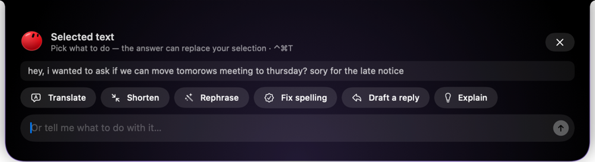</div>

<div dir="rtl">

### 🎙 הכתבה בכל מקום — ⌃⌘J
מדברים, והטקסט מוקלד איפה שהסמן נמצא — בעברית או באנגלית, בכל אפליקציה. ובנוסף **⌃⌘P** לבקשה קולית ("תזכיר לי בעוד 20 דקות…") ו־**⌃⌘L** לשאלה על מה שעל המסך.

</div>

<div align="center">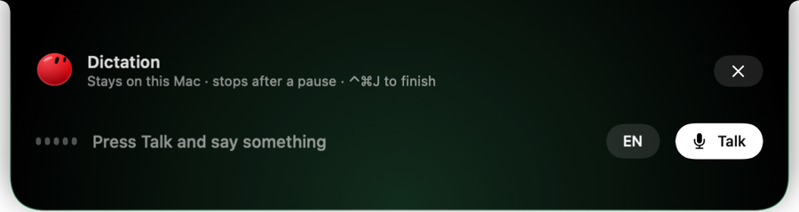</div>

<div dir="rtl">

### ⌨️ כתבתם במקלדת הלא נכונה? זה מתוקן לבד
`akuo` ← **שלום**, `Hקךךם` ← **Hello**, ואפילו שגיאות הקלדה (`jusr` ← **just**). מבין את ההקשר של המשפט, **לומד את סגנון הכתיבה שלכם**, ו־⌫ מיד אחרי מבטל.

### 🗜 גוררים קובץ ל־notch
- **תמונות:** המרה ל־**WebP / AVIF** (עד 94% קטן יותר), JPG/PNG, הקטנה, הסרת רקע, העתקת טקסט מתמונה (OCR)
- **וידאו:** כיווץ בלי לאבד איכות או פריימים, כיווץ אל מתחת ל־5MB, יצירת GIF
- **PDF:** כיווץ, איחוד, יצירה מתמונות · ZIP · AirDrop, מייל ו־WhatsApp

</div>

<div align="center">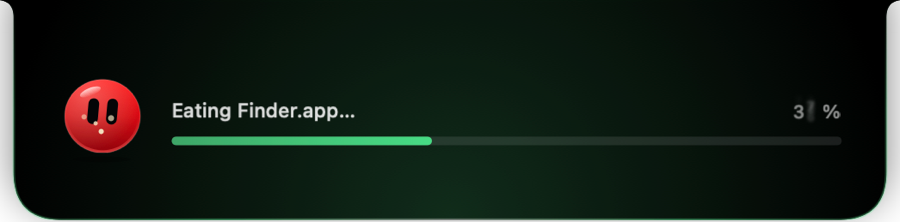</div>

<div dir="rtl">

### 📋 היסטוריית העתקות — ⌃⌘V
כל מה שהעתקתם, עם חיפוש. (סיסמאות לא נשמרות.)

</div>

<div align="center">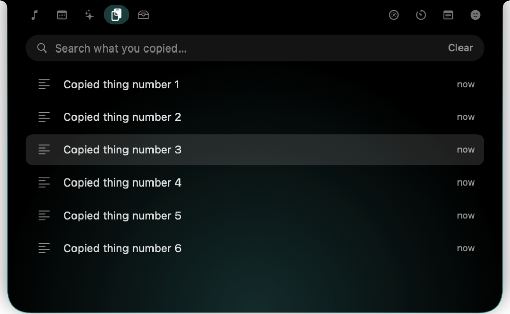</div>

<div dir="rtl">

### ⚡️ Power-ups — מה שהמק היה צריך לעשות מזמן
מחליף חלונות עם תצוגה מקדימה, הצמדת חלונות לקצוות, אייקונים שהוסתרו מאחורי ה־notch, החלפת רמקולים ואוזניות בקליק, בהירות למסכים חיצוניים, תצוגה מקדימה של חלונות ב־Dock, קיצורי טקסט, הסרת אפליקציות עם כל השאריות, השארת המק ער, ושמירה על הסוללה.

</div>

<div align="center">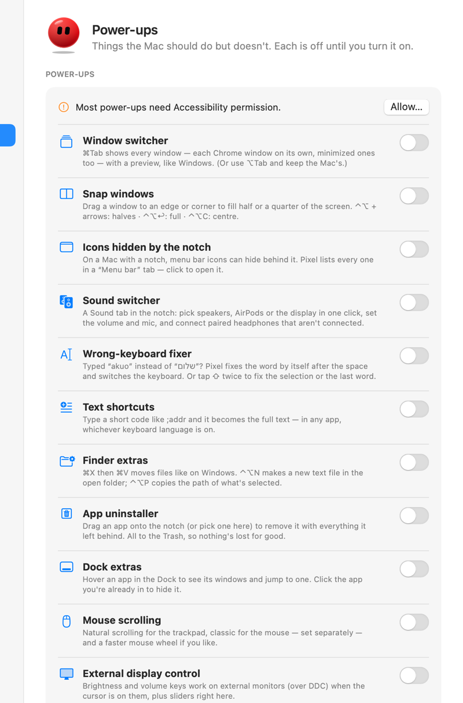</div>

<div dir="rtl">

### 🎵 ועוד ב־notch
מוזיקה שמתנגנת (והחבר רוקד לקצב), הפגישה הבאה עם כפתור הצטרפות, טיימרים וריכוז, תזכורות לשתות ולנוח, פתקים, יומן מצב רוח, בריאות המק, ההורדות וצילומי המסך האחרונים — ו**מצב מצגת**: בזמן שיתוף מסך Pixel נעלם ושותק.

---

## 📥 התקנה

### הדרך הקלה — שורה אחת, בלי שום אזהרה
1. פותחים **Terminal**: ⌘ + רווח, מקלידים `Terminal`, Enter
2. מדביקים את השורה הזאת ולוחצים Enter:

</div>

```bash
curl -fsSL https://raw.githubusercontent.com/GorenCode/pixel-releases/main/install.sh | bash
```

<div dir="rtl">

3. זהו — Pixel מותקן בתיקיית Applications ונפתח לבד. Cherry מקבל אתכם ושואל במה לעזור 🍒

### או הורדה רגילה
1. **[מורידים את Pixel.zip](https://github.com/GorenCode/pixel-releases/releases/latest/download/Pixel.zip)** (קובץ אחד — Safari פותח אותו לבד)
2. גוררים את **Pixel** מתיקיית ההורדות לתיקיית **Applications** ופותחים
3. macOS יגיד שהוא לא יכול לאמת את האפליקציה (כי היא חינמית ולא נרכשה מאפל) — לוחצים **Done**, נכנסים ל**הגדרות מערכת ← פרטיות ואבטחה**, גוללים למטה ולוחצים **"פתח בכל זאת"**. פעם אחת בלבד.

<div align="center">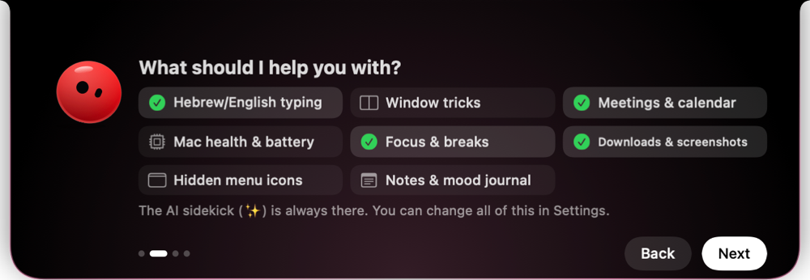</div>

**עדכונים:** Pixel בודק כל כמה שעות אם יש גרסה חדשה ושואל לפני שהוא מתקין. רוצים עכשיו? אייקון Pixel בשורת התפריטים ← **Check for Updates…**

## 🔒 פרטיות

- **אין שרת של Pixel.** כל העיבוד קורה על המק שלכם — קבצים, תמונות, וידאו, היסטוריית העתקות, לימוד הכתיבה.
- מה שנשלח החוצה: רק מה שאתם שולחים בעצמכם ל־AI שבחרתם, והכתבה בעברית (שעוברת דרך אפל, כמו הכתבה של Siri).
- לימוד הכתיבה שומר רק "טביעות אצבע" של מילים, אף פעם לא טקסט, ולא לומד משדות סיסמה, טרמינלים ומנהלי סיסמאות.
- כל עדכון חתום דיגיטלית — אף אחד לא יכול לשלוח עדכון מזויף.

## ⌨️ קיצורי מקלדת

| קיצור | מה זה עושה |
|---|---|
| ⌃⌘P | לדבר עם Pixel |
| ⌃⌘J | הכתבה איפה שהסמן |
| ⌃⌘T | פעולות על טקסט מסומן |
| ⌃⌘L | שאלה על מה שעל המסך |
| ⌃⌘V | היסטוריית העתקות |
| ⌃⌘N | פתק מהיר |
| ⇧ ⇧ | תיקון מקלדת למילה האחרונה / לטקסט מסומן |

---

<div align="center">

נוצר באהבה לצוות של **[CHERRY.](https://cherry.co.il)** 🍒

</div>

</div>
